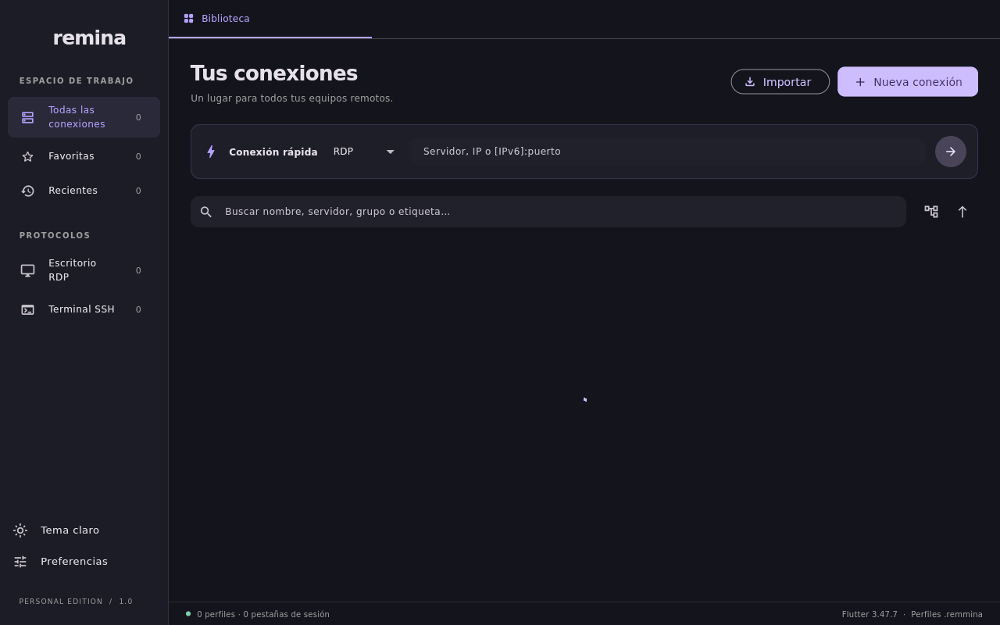

# Remina Desktop

Cliente de escritorio remoto multiplataforma para **Linux, macOS y Windows**, escrito en **Flutter 3.47.7** con **FVM**. Biblioteca de conexiones compatible con perfiles `.remmina`, editor, grupos, búsqueda, favoritos, conexión rápida y sesiones SSH integradas.

**La distribución incluye el motor RDP y sus bibliotecas. El equipo donde se ejecuta no necesita instalar FreeRDP, Homebrew, Flutter ni dependencias de desarrollo.** El escritorio RDP se ejecuta en una ventana nativa de FreeRDP con resolución dinámica y aceleración gráfica.




## Usar el paquete compilado

**Linux:** extrae `dist/Remina-Desktop-linux-x86_64.tar.xz` y ejecuta `bundle/remina`. Copia la carpeta **completa**, no únicamente ese archivo. Incluye FreeRDP 3, GTK/GLib, libsecret, bibliotecas gráficas Mesa/EGL, fuentes, certificados y el cargador ELF. Se necesita un escritorio Linux compatible con la arquitectura del paquete; no es un servidor gráfico ni un controlador del kernel.

**macOS:** el script de compilación produce `dist/Remina-Desktop-macos.zip`. Extrae y copia `Remina Desktop.app` a Aplicaciones. El helper se guarda en `Contents/MacOS` y sus dylibs en `Contents/Frameworks/ReminaRdp`. Las rutas a bibliotecas se reescriben para quedar dentro de la app. El paquete es para la arquitectura del Mac que lo compila; su versión mínima de macOS se ajusta a la exigida por las bibliotecas incluidas.

**Windows:** la compilación genera la carpeta autocontenida en `build/windows/x64/runner/Release/`. Se ejecuta mediante `remina.exe` (Remina Desktop) y busca el motor RDP (`remina-rdp.exe` o `wfreerdp.exe`) en el mismo directorio de la aplicación o en `PATH`.

El motor se busca dentro del paquete (y en Windows además en `PATH` para FreeRDP nativo). Una distribución incompleta se informa antes de pedir la contraseña.

## Compilar desde código fuente

Estas herramientas se necesitan **solo en el equipo de desarrollo**, donde se compila y se arma el paquete; no en los equipos de destino.

### Linux

En Ubuntu/Debian:

```bash
tools/setup_linux.sh
fvm install
fvm flutter pub get
fvm flutter run -d linux
```

CMake incluye automáticamente el motor y las bibliotecas al montar el bundle, tanto en debug como en release. Si falta un recurso necesario, el build falla. La entrada de FreeRDP puede ser el cliente instalado en el equipo de compilación, `REMINA_FREERDP_SOURCE=/ruta/a/xfreerdp` o la copia local que prepara `tools/setup_rdp_linux.sh`. Ninguna de esas rutas se conserva como dependencia en la distribución final.

Para generar el archivo que se puede copiar a otro equipo:

```bash
tools/build_linux.sh
```

Salida: `dist/Remina-Desktop-linux-<arquitectura>.tar.xz`, con permisos de ejecución preservados. La carpeta `build/linux/<plataforma>/release/bundle` también se puede trasladar completa.

### macOS

Requiere Xcode, Python 3, FVM y una entrada FreeRDP 3 en el equipo de compilación. El script puede preparar esa entrada con Homebrew; también puedes proporcionar `REMINA_FREERDP_SOURCE` de una compilación propia.

```bash
dart pub global activate fvm
tools/build_macos.sh
```

El paso nativo de Xcode copia el helper, recorre y copia las dylibs no provistas por macOS, corrige sus referencias y firma el código incluido. Xcode firma después la app exterior. Las comprobaciones de firma se ejecutan antes de producir el ZIP. La firma para distribución y la notarización dependen de la configuración del desarrollador; el proyecto está destinado al uso personal y tiene App Sandbox desactivado.

### Windows

Requiere Windows 10/11 con Visual Studio 2022 (carga de trabajo "Desarrollo para el escritorio con C++"), FVM y Flutter.

```bash
fvm install
fvm flutter pub get
fvm flutter run -d windows
```

Para generar la compilación de producción:

```bash
fvm flutter build windows --release
```

Salida: `build/windows/x64/runner/Release/`

## Traer tus conexiones

1. Copia tus archivos `~/.local/share/remmina/*.remmina` desde Linux.
2. Pulsa **Importar** y selecciónalos. En Linux puedes usar **Importar Remmina de este equipo**.
3. Conecta con doble clic y escribe la contraseña. Puedes guardarla en el llavero del nuevo equipo.

La app usa copias propias y conserva los archivos originales, claves desconocidas, comentarios, secciones y escapes GLib. **Exportar .remmina** produce archivos legibles por Remmina. Las rutas de llaves SSH y carpetas compartidas se deben adaptar al nuevo equipo.

`password=.` hace referencia al llavero original; no transfiere su contraseña. Las credenciales cifradas de Remmina se conservan como datos opacos y se vuelven a solicitar al conectar. Las contraseñas nuevas se guardan opcionalmente en el llavero del sistema, nunca como texto plano en `.remmina`. Si el sistema no ofrece un servicio de llavero, la conexión funciona sin guardar contraseñas.

## Funciones y límites

| Función | Estado |
|---|---|
| Biblioteca | Grupos/lista, búsqueda, favoritos, recientes, editar, duplicar y borrar copias |
| SSH | Terminal Flutter, PTY, resize, portapapeles, contraseña/llave y MFA |
| Confianza SSH | Huella SHA256 en primer acceso y rechazo de cambios posteriores; registro propio |
| RDP | Helper incluido con sus bibliotecas; ventana separada y control desde la pestaña |
| Ajustes RDP | Usuario/dominio, resolución, escala, color estándar, seguridad, clipboard, certificados, audio, carpeta, impresora, consola, multimonitor y reconexión |
| Gateway | Mapeo de configuración implementado; falta prueba contra un gateway real |
| Otras configuraciones | Se conservan en los archivos aunque no estén implementadas |
| Pendiente | RDP dentro de Flutter, VNC/SFTP/SPICE, túneles, agente SSH, GSSAPI y canales/dispositivos avanzados |

Los perfiles con túneles o comandos proxy/hooks no implementados se rechazan. `resolution_mode`: `0=personalizada`, `1=cliente`, `2=ventana inicial`; `scale=2` activa la resolución dinámica. `colordepth=99` conserva la negociación de FreeRDP. `cert_ignore=0` exige validación del certificado; `1` respeta la decisión del perfil de omitirla.

La contraseña RDP se pasa por stdin, fuera de los argumentos del proceso. El estado de la pestaña indica si el helper está activo; la autenticación se muestra en su ventana. Cerrar una pestaña desconecta; la salida normal de la app solicita confirmación cuando hay sesiones.

## Guía de herramientas y scripts (`tools/`)

El directorio `tools/` contiene utilidades especializadas para la preparación de dependencias, compilación multiplataforma, empaquetado hermético y pruebas de humo:

### 1. Entorno de desarrollo y dependencias
- **`tools/setup_linux.sh`**
  - **Propósito:** Prepara e instala las herramientas nativas de compilación en Linux (Ubuntu/Debian) necesarias para Flutter de escritorio (`clang`, `cmake`, `ninja`, `pkg-config`, `libgtk-3-dev`, `libsecret-1-dev`, fuentes DejaVu).
  - **Uso:**
    ```bash
    tools/setup_linux.sh          # Instala dependencias faltantes con apt
    tools/setup_linux.sh --check  # Solo verifica dependencias (código 0 si todo está listo)
    ```
- **`tools/setup_rdp_linux.sh`**
  - **Propósito:** Descarga y extrae localmente un binario de FreeRDP 3 sin requerir privilegios de superusuario (`sudo`), preparándolo en `~/.local/share/remina/engines/freerdp/bin/xfreerdp` como entrada de compilación para CMake.
  - **Uso:**
    ```bash
    tools/setup_rdp_linux.sh
    ```

### 2. Compilación y empaquetado de producción
- **`tools/build_linux.sh`**
  - **Propósito:** Automatiza el pipeline de producción en Linux: analiza el código, ejecuta los tests unitarios, compila el bundle release con Flutter, valida la integridad del paquete y comprime el archivo distribuible `dist/Remina-Desktop-linux-<arch>.tar.xz`.
  - **Uso:**
    ```bash
    tools/build_linux.sh
    ```
- **`tools/build_macos.sh`**
  - **Propósito:** Automatiza el pipeline de producción en macOS: compila la app release, valida y reescribe las dylibs de FreeRDP 3 incluidas, verifica la firma con `codesign` y genera el archivo `dist/Remina-Desktop-macos.zip`.
  - **Uso:**
    ```bash
    tools/build_macos.sh
    ```
- **`tools/packaging/bundle_runtime.py`**
  - **Propósito:** Motor de empaquetado hermético invocado por CMake/Xcode. Resuelve el árbol de dependencias binarias (ELF en Linux, Mach-O/dylibs en macOS), copia bibliotecas del sistema requeridas a la carpeta de la app, reescribe `rpath` y rutas dinámicas (`@loader_path`), e incrusta el archivo `runtime-manifest.json` con los hashes SHA256 de cada archivo distribuido.
  - **Uso:** Invocado internamente durante `flutter build` o manualmente:
    ```bash
    python3 tools/packaging/bundle_runtime.py --platform linux --root build/linux/x64/release/bundle
    ```

### 3. Branding y exportación de íconos
- **`tools/export_icons.sh`**
  - **Propósito:** Exporta todos los recursos visuales e íconos de la aplicación a partir del master `assets/branding/remina-macos.png` usando ImageMagick. Produce las marcas para la UI (64, 128, 256 px), el catálogo nativo de macOS (`AppIcon.appiconset` de 16 a 1024 px) y el archivo de íconos multi-resolución para Windows (`windows/runner/resources/app_icon.ico`).
  - **Uso:**
    ```bash
    tools/export_icons.sh
    ```

### 4. Pruebas de humo, validación y verificación
- **`tools/rdp_smoke.dart`**
  - **Propósito:** Prueba de arranque seguro del motor RDP en Dart. Instancia un perfil RDP contra un puerto loopback efímero cerrado (127.0.0.1) para comprobar que FreeRDP recibe argumentos válidos y lee la contraseña vía stdin, verificando que rechace conexiones de forma controlada sin comunicarse con servidores reales.
  - **Uso:**
    ```bash
    fvm dart run tools/rdp_smoke.dart [ruta-al-binario-rdp]
    ```
- **`tools/packaging/verify_linux_bundle.py`**
  - **Propósito:** Valida que una distribución de Linux esté íntegra: comprueba los hashes SHA256 contra el manifiesto y analiza con el cargador ELF que ninguna biblioteca externa del host sea enlazada inadvertidamente. Soporta además validación en un contenedor Docker aislado.
  - **Uso:**
    ```bash
    python3 tools/packaging/verify_linux_bundle.py build/linux/x64/release/bundle
    python3 tools/packaging/verify_linux_bundle.py build/linux/x64/release/bundle --container alpine:latest
    ```
- **`tools/packaging/smoke_isolated_linux.py`**
  - **Propósito:** Prueba de humo GUI en entorno aislado. Arranca un servidor virtual Xvfb y ejecuta la aplicación completa dentro de un contenedor Docker limpio (Ubuntu/Alpine sin red), verificando que la ventana Flutter se mapee y renderice sin errores de OpenGL ni dependencias faltantes.
  - **Uso:**
    ```bash
    python3 tools/packaging/smoke_isolated_linux.py build/linux/x64/release/bundle --image ubuntu:24.04
    ```
- **`tools/packaging/tests/test_packaging.py`**
  - **Propósito:** Suite de pruebas unitarias (`unittest`) de Python para verificar la lógica de empaquetado hermético de `bundle_runtime.py` (detección de colisiones de bibliotecas, resolución de rpaths y comprobación de dependencias dinámicas).
  - **Uso:**
    ```bash
    python3 -m unittest discover -s tools/packaging/tests
    ```

[GitHub Actions](.github/workflows/desktop.yml) ejecuta builds y comprobaciones automatizadas para Linux, macOS y Windows en cada push y pull request.

## Investigación, Reingeniería Limpia (REA) y Aviso Legal

Este repositorio es el resultado de un proceso de **reingeniería inversa y análisis de interoperabilidad (REA - Reverse Engineering Analysis)** sobre artefactos públicos y bibliotecas abiertas (Remmina 1.4.43 y FreeRDP 3), con el fin de crear un cliente multiplataforma moderno e independiente.

> [!IMPORTANT]
> **Fines no comerciales:** Este proyecto se desarrolla y comparte estrictamente con fines **educativos, de investigación técnica, interoperabilidad y uso personal**. No persigue ningún fin de lucro ni explotación comercial.

### Principios de legalidad y diseño en sala limpia (*Clean-Room*)
- **Reimplementación independiente:** Todo el código en Flutter/Dart es una implementación original y nueva. No se copió ni incluyó código fuente original ni pseudocódigo descompilado del proyecto Remmina.
- **Interoperabilidad legítima:** La compatibilidad con el formato de perfiles `.remmina` (formato de texto plano basado en especificaciones GLib KeyFile) y la integración con FreeRDP y SSH se basan en estándares abiertos y documentación pública con el único propósito de interoperar con configuraciones y servidores existentes.
- **Seguridad y privacidad:** No se almacenan contraseñas en texto claro, no se vulneran esquemas de cifrado del sistema y las credenciales viajan exclusivamente a través de flujos estándar y seguros (llavero nativo del SO y stdin del proceso motor).
- **Atribución y marcas registradas:** Remmina es un proyecto de software libre licenciado bajo GNU GPL. **Remina Desktop** es un cliente no oficial e independiente; no está asociado, respaldado, patrocinado ni vinculado de ninguna forma a los autores, mantenedores u organizaciones detrás de Remmina o FreeRDP.

### Evidencia de investigación
La investigación técnica original se realizó sobre Remmina 1.4.43 y su plugin RDP mediante herramientas de análisis estático (REA MCP + Hopper). Los hallazgos, procedimientos y mapeos de configuración se encuentran detallados en el [Informe técnico](docs/reverse-engineering/REPORT.md) y el [índice de evidencias](docs/reverse-engineering/evidence.json).

Referencias primarias: [FreeRDP](https://github.com/FreeRDP/FreeRDP), [configuración Remmina](https://remmina.gitlab.io/remminadoc.gitlab.io/md__builds__remmina_remmina_ci__remmina_wiki__remmina__config__file__options.html), [ubicación de código en bundles macOS](https://developer.apple.com/documentation/bundleresources/placing-content-in-a-bundle), [firma de código anidado](https://developer.apple.com/library/archive/technotes/tn2206/). Las licencias de las bibliotecas incluidas se conservan íntegramente en el paquete.

### Licencia del proyecto
El código original de Remina Desktop se distribuye bajo la **[Licencia MIT](LICENSE)**. Las bibliotecas, fuentes y motores empaquetados o enlazados (FreeRDP, Flutter, GTK, SQLite, OpenSSL) conservan sus respectivas licencias originales (Apache 2.0, BSD, LGPL/GPL, MIT).

La aplicación incluye dentro de la barra lateral la opción **Acerca de y Licencias**, donde se puede consultar la versión activa, el marco legal y el desglose interactivo de todas las licencias de dependencias (`showLicensePage`).
