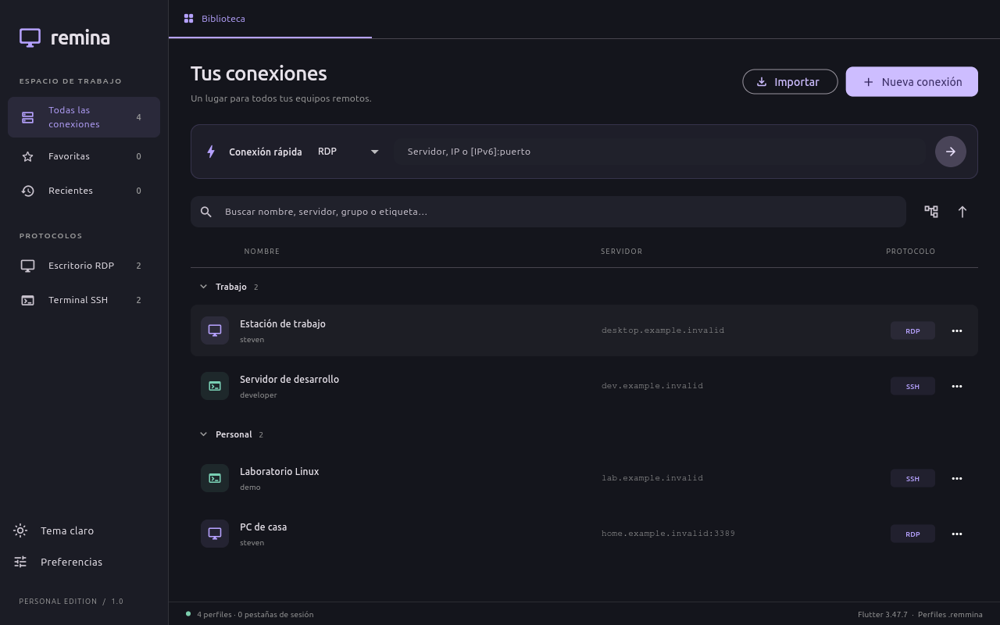

# Remina · Personal Edition

Cliente personal de escritorio escrito en **Flutter 3.47.7**, fijado con **FVM**. Recupera el flujo de Remmina: biblioteca agrupada, búsqueda, conexión rápida, editor de perfiles, importación/exportación y sesiones en pestañas. Plataformas del proyecto: macOS y Linux.



## Ejecutar en tu Mac

Requiere Xcode con sus herramientas de desarrollo, FVM y FreeRDP 3 para RDP.

```bash
dart pub global activate fvm
brew install freerdp
fvm install
fvm flutter pub get
fvm flutter run -d macos
```

FreeRDP se detecta en `/opt/homebrew/bin` (Apple Silicon), `/usr/local/bin` (Intel) y `PATH`. Si tu instalación usa otra ruta, selecciónala en **Preferencias**, o establece `REMINA_FREERDP`. Se prefiere `sdl-freerdp`, que muestra la sesión en una ventana nativa independiente. No se necesita tener Remmina instalada.

Para generar la aplicación y su ZIP:

```bash
tools/build_macos.sh
```

Salida: `build/macos/Build/Products/Release/Remina.app` y `dist/Remina-macos.zip`. FreeRDP se instala por separado en cada Mac. El proyecto usa el llavero de macOS sin Keychain Sharing y permite lanzar el motor externo; el App Sandbox está desactivado para este uso personal. La firma final depende de tu configuración local de Xcode.

## Traer tus conexiones

1. Copia tus archivos `~/.local/share/remmina/*.remmina` desde Linux al Mac.
2. Pulsa **Importar** y selecciona los archivos. En Linux puedes usar **Importar Remmina de este equipo**.
3. Abre un perfil con doble clic y escribe su contraseña. Puedes guardarla en el llavero del nuevo equipo.

La app trabaja sobre copias en su directorio de soporte. Nunca modifica tus perfiles de origen. Conserva claves desconocidas, comentarios, secciones adicionales y escapes de GLib. **Exportar .remmina** produce un perfil que Remmina puede volver a leer. Las ediciones conservan los campos de plugins aunque esta versión no ejecute todas sus funciones.

**Contraseñas:** `password=.` es una referencia al llavero original, no una contraseña transferible. Las contraseñas cifradas antiguas se conservan como datos opacos y tampoco se descifran. Debes introducirlas de nuevo; las nuevas se guardan opcionalmente en el llavero del sistema, nunca como texto plano en `.remmina`. Las rutas de llaves SSH y carpetas compartidas deben ajustarse a las rutas de tu Mac. No hay sincronización automática entre equipos.

## Funciones y límites

| Función | Implementación |
|---|---|
| Biblioteca | Grupos plegables, lista, búsqueda, favoritos, recientes, duplicación, edición y borrado de copias |
| Conexión rápida | RDP o SSH, con usuario y contraseña al conectar |
| SSH | Terminal dentro de Flutter, PTY, teclado, portapapeles, resize, contraseña, llave privada y autenticación interactiva/MFA |
| Identidad SSH | Confirmación de la huella SHA256 en el primer acceso; rechaza cambios posteriores. Registro propio, independiente de `known_hosts` |
| RDP | Motor FreeRDP 3 externo con ventana nativa; pestaña para iniciar/detener y ver diagnóstico |
| Ajustes RDP traducidos | Servidor, usuario/dominio, resolución, escala dinámica, color estándar, NLA/TLS/RDP, clipboard, certificados, audio, carpeta, impresora, consola, multimonitor y reconexión |
| Gateway RDP | Servidor, usuario/dominio y contraseña separada; pendientes pruebas contra un gateway real |
| Configuración conservada | Las claves no implementadas permanecen en el archivo, sin aplicarse a la conexión |
| Otros protocolos | VNC, SFTP, SPICE y plugins: se pueden conservar/importar, pero no conectar |
| Pendiente | Escritorio RDP embebido en Flutter, túneles/saltos SSH, agente SSH, GSSAPI, X11 forwarding, transferencia SFTP y opciones avanzadas de dispositivos/canales |

Los perfiles con túneles SSH o comandos de proxy/hooks se rechazan explícitamente al conectar. `precommand` y `postcommand` no se ejecutan. En RDP, `cert_ignore=0` se traduce a validación estricta (`/cert:deny`): un certificado no confiable impide conectar. `cert_ignore=1` respeta la decisión del perfil de omitir esa validación. El modo de resolución se interpreta como `0=personalizada`, `1=cliente`, `2=ventana inicial`; `scale=2` activa por separado la resolución dinámica. `colordepth=99` conserva la negociación predeterminada de FreeRDP; no significa 99 bits.

Las credenciales RDP se envían por **stdin**, fuera de los argumentos visibles del proceso. El estado «FreeRDP en ejecución» refleja el proceso; el resultado de autenticación se muestra en su ventana. Las pestañas de sesión conservan el estado al cambiar entre ellas. Cerrar una pestaña desconecta; la salida normal de la app solicita confirmación si hay sesiones abiertas.

## Desarrollo y verificación

```bash
fvm flutter analyze
fvm flutter test
fvm flutter run -d linux
fvm flutter build linux --release
```

En Ubuntu/Debian, el build de Linux necesita `clang cmake ninja-build pkg-config libgtk-3-dev libsecret-1-dev` y herramientas C++. Para RDP instala el paquete `freerdp-x11`/`freerdp3-x11` o el cliente SDL equivalente de tu distribución. El llavero de Linux requiere un servicio Secret Service disponible; si falta, puedes conectar sin guardar contraseñas.

Las pruebas cubren roundtrip GLib, preservación de claves y secretos opacos, importación idempotente, protección de originales, guardado atómico, editor, búsqueda, filtros, identidades SSH y paso de credenciales al motor RDP mediante un proceso local. Hay una prueba SSH optativa contra un servidor de fixture en `127.0.0.1`; consulta [la validación](docs/VALIDATION.md). No se han utilizado tus servidores para las pruebas.

El workflow [desktop.yml](.github/workflows/desktop.yml) prepara validación y builds Linux/macOS al ejecutarse en GitHub. No se ha publicado ni ejecutado remotamente desde esta sesión.

## Ícono de la aplicación

El catálogo de macOS y la barra lateral usan una variante generada de Remmina: azul/verde y símbolos de conexión combinados con un rostro inspirado en Finder. El [master transparente de 1024 px](assets/branding/remina-macos.png), las variantes de tamaño y los prompts están en [assets/branding](assets/branding/README.md). Para reproducir la exportación de tamaños: `tools/export_icons.sh` (ImageMagick). Los PNG ya están incluidos; no hace falta ejecutar el script para compilar.

## Investigación

El análisis se hizo sobre `/usr/bin/remmina` **1.4.43** y su plugin RDP mediante **REA MCP + Hopper**. [Informe y límites](docs/reverse-engineering/REPORT.md), [índice de evidencias](docs/reverse-engineering/evidence.json).

La arquitectura Flutter y el código de esta app son implementaciones nuevas. El análisis estático describe el artefacto instalado; no equivale a observar todas las funciones en ejecución. Remmina y sus motores conservan sus propias licencias.

Referencias primarias: [formato de configuración de Remmina](https://remmina.gitlab.io/remminadoc.gitlab.io/md__builds__remmina_remmina_ci__remmina_wiki__remmina__config__file__options.html), [FreeRDP en macOS](https://github.com/FreeRDP/FreeRDP/wiki/Compilation), [fórmula Homebrew](https://formulae.brew.sh/formula/freerdp) y [CLI de FreeRDP 3.32.1](https://github.com/FreeRDP/FreeRDP/blob/3.32.1/client/common/cmdline.c).
